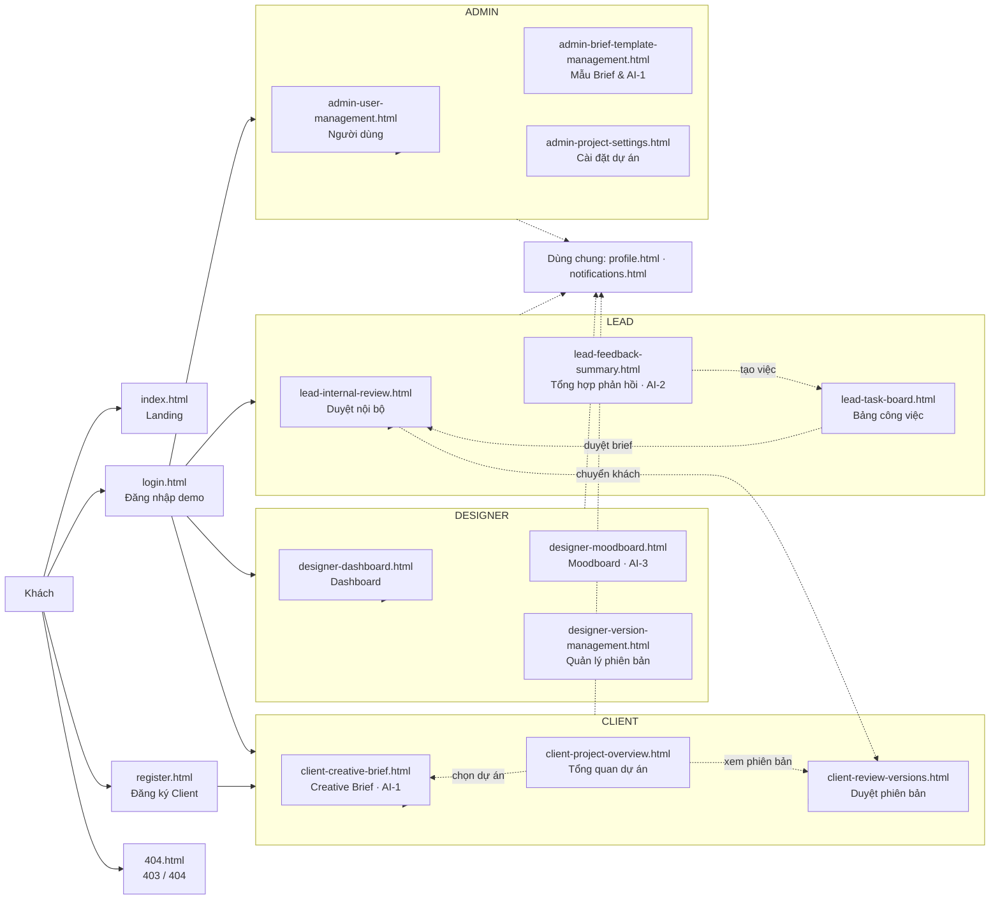
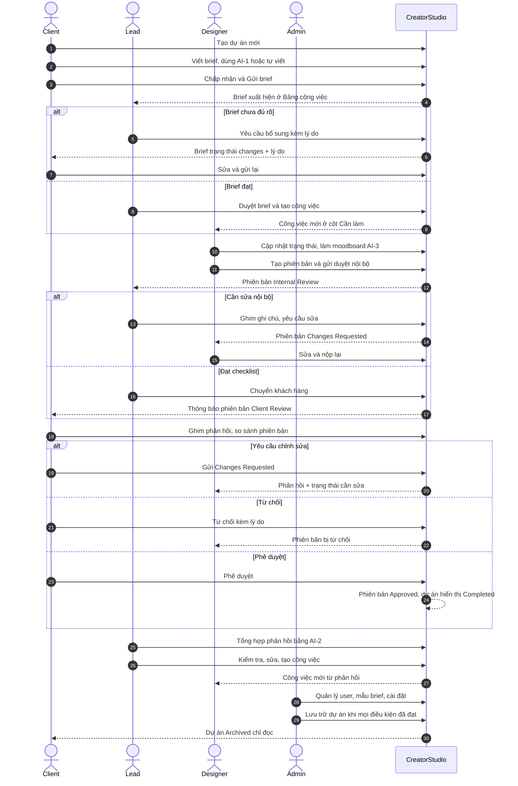

> Khôi phục từ bản sao lưu ngày 25/10/2026. Nội dung dự thảo/lịch sử cần đối chiếu; số liệu hiện hành ưu tiên README gốc và evidence-index. Chưa xác nhận link Figma/Trello/deploy hoặc kết quả chưa chạy lại.

# User Flow & ma trận trạng thái — CreatorStudio

Tài liệu mô tả luồng người dùng end-to-end và vòng đời dữ liệu của bản tích hợp. Nội dung bám theo code tại nhánh `feature/task29-final-evidence` (kế thừa `dev` commit `1681295`), không mô tả tính năng chưa có.

- Nguồn dữ liệu duy nhất: `localStorage` khóa `creatorstudio.team.v1`, truy cập qua [js/store.js](../../js/shared/store.js).
- Client dùng adapter [js/client-store-adapter.js](../../js/shared/client-store-adapter.js) để đọc/ghi cùng Store, không có database thứ hai.
- Điều hướng và phân quyền: [js/modules/navigation.js](../../js/shared/modules/navigation.js).
- Không có backend, không có đăng nhập bảo mật; đây là phiên demo có chọn vai trò.

## 1. Sitemap theo vai trò

Trang tiện ích không nằm trong 18 màn chính: `role-preview.html` (xem nhanh 4 vai trò), `BAT-DAU.html` (điểm bắt đầu nội bộ), `api-demo.html` (demo REST API độc lập, không nối Store).

## 2. Luồng end-to-end: từ ý tưởng đến dự án hoàn thành

### Điều kiện chuyển bước quan trọng (theo code)

| Bước | Điều kiện thực tế | Nơi kiểm tra |
|---|---|---|
| Gửi brief | Đã chấp nhận nội dung, đủ 5 phần, có hạn; ngân sách hợp lệ nếu nhập | `client-creative-brief.js` + adapter |
| Duyệt brief | Brief `submitted`; tạo task ở `todo`; cần người phụ trách, ưu tiên, hạn hợp lệ | `Store.brief` |
| Gửi duyệt nội bộ | Phiên bản `Draft` hoặc `Changes Requested`; nếu bật `requireReview` phải tick đủ checklist nghiệm thu | `Store.submitVersionForReview` |
| Chuyển khách | Phiên bản `Internal Review`; đủ 2 checklist nội bộ; không còn ghi chú chưa xử lý | `Store.review('pass')` |
| Yêu cầu sửa nội bộ | Lý do ≥ 8 ký tự; phiên bản về `Changes Requested` | `Store.review('rework')` |
| Phản hồi của Client | Phiên bản đang `Client Review`; phản hồi ≥ 3 ký tự | `client-store-adapter.js` |
| Phê duyệt của Client | Phiên bản `Client Review`; dự án hiển thị `Completed` | `client-review-versions.js` + adapter |
| Lưu trữ dự án | Không còn task chưa `done`; mọi brief `approved`; mọi phiên bản `Approved`/`Archived` | `Store.archive` |
| Xóa dự án | Chỉ dự án đã lưu trữ, không còn dữ liệu liên kết, còn ít nhất 1 dự án | `client-store-adapter.js` |

## 3. Luồng theo từng vai trò

### 3.1. Client

1. Đăng nhập bằng tài khoản Client demo → Tổng quan dự án.
2. Tạo dự án (tên, mô tả, loại, hạn) → hệ thống chuyển sang trang Brief.
3. Viết brief: nhập mô tả thô → AI-1 gợi ý 5 phần → sửa → chấp nhận → gửi. Có thể lưu nháp, tạo lại, từ chối gợi ý hoặc tự viết.
4. Theo dõi trạng thái brief và phiên bản ở Tổng quan dự án.
5. Khi Lead chuyển phiên bản sang `Client Review`, nhận thông báo → mở Duyệt phiên bản.
6. So sánh phiên bản trước/sau, ghim phản hồi, đánh dấu đã xử lý, rồi Phê duyệt / Yêu cầu chỉnh sửa / Từ chối.
7. Sau khi duyệt, phiên bản chỉ đọc; dự án hiển thị Hoàn thành.

### 3.2. Lead

1. Mở Bảng công việc → thấy brief mới đang chờ duyệt.
2. Mở brief → Duyệt & tạo công việc (điền người phụ trách, ưu tiên, hạn) hoặc Yêu cầu bổ sung (lý do ≥ 8 ký tự).
3. Theo dõi Kanban 4 cột; kéo thả hoặc đổi trạng thái; xem hoạt động gần đây.
4. Khi Designer nộp phiên bản → Duyệt nội bộ: xem ảnh/moodboard, ghim ghi chú, tick checklist, yêu cầu sửa hoặc chuyển khách.
5. Khi khách phản hồi → Tổng hợp phản hồi: chọn phản hồi → AI-2 tạo đề xuất → sửa/bỏ/làm rõ → tạo công việc trên Kanban.

### 3.3. Designer

1. Dashboard: xem việc được giao, mức ưu tiên, hạn; đổi trạng thái; tạo việc cho chính mình.
2. Moodboard: thêm/xóa thẻ, màu, từ khóa; dùng AI-3 gợi ý palette; áp dụng hoặc tự nhập.
3. Quản lý phiên bản: tạo phiên bản, tải ảnh, sửa nháp, nộp duyệt nội bộ; xóa nháp; lưu trữ.
4. Khi bị yêu cầu sửa: mở phiên bản `Changes Requested`, sửa và nộp lại.

### 3.4. Admin

1. Quản lý người dùng: tìm/lọc, thêm/sửa, khóa/mở khóa; không thể tự khóa hoặc khóa Admin cuối.
2. Quản lý mẫu Brief: chọn mẫu, sửa prompt AI-1, thêm mẫu, bật/tắt.
3. Cài đặt dự án: cảnh báo hạn, mẫu mã phiên bản, bắt buộc checklist; quản lý nhãn; lưu trữ dự án có xác nhận.

## 4. Entity và quyền thao tác

| Entity | Khóa dữ liệu | Tạo bởi | Đọc bởi | Cập nhật bởi | Xóa / lưu trữ | Trạng thái hiện có |
|---|---|---|---|---|---|---|
| Project | `projects` | Client | Tất cả vai trò | Client (thông tin, lưu trữ/khôi phục); Lead/Designer (status nghiệp vụ); Admin (lưu trữ) | Client xóa dự án đã lưu trữ, không còn dữ liệu liên kết; Admin lưu trữ | `archived` true/false; hiển thị Active / In Review / Completed / Archived |
| Brief | `briefs` | Client (adapter) | Client, Lead, Admin | Client (nội dung, gửi lại); Lead (duyệt/yêu cầu bổ sung) | **Chưa có xóa** | `draft` → `submitted` → `approved` / `changes` |
| Task | `tasks` | Lead; Designer (cho chính mình); hệ thống từ brief/AI-2 | Tất cả | Lead; Designer được giao | Lead hủy kèm lý do; xóa vĩnh viễn **chỉ task đã hủy** | `todo`, `doing`, `review`, `done`, `cancelled` |
| Version | `versions` | Designer/Lead | Client (bản public), Lead, Designer | Designer/Lead khi `Draft`/`Changes Requested`; Lead chuyển bước; Client quyết định | Designer xóa `Draft`; lưu trữ phiên bản | `Draft`, `Internal Review`, `Client Review`, `Changes Requested`, `Approved`, `Archived`; Client có thể ghi `Rejected` |
| Comment | `comments` | Client (adapter); Lead thêm phản hồi khách | Client, Lead, Designer | Client sửa/resolve; Lead resolve | Client xóa | `resolved` true/false |
| Note nội bộ | `notes` | Lead | Lead, Designer (theo màn hình) | Lead sửa/resolve | **Chưa có xóa** | `resolved` true/false |
| Proposal AI-2 | `proposals` | Lead qua AI-2 | Lead | Lead sửa/làm rõ | Lead bỏ đề xuất | Chờ xử lý → đã chuyển thành task (`taskId`) |
| User | `users` | Seed; Admin; Register (Client) | Tất cả (thông tin hiển thị) | Admin; người dùng tự sửa hồ sơ | Admin xóa khi không liên kết dữ liệu; chặn tự xóa/Admin cuối; khóa/mở khóa | `active` true/false |
| BriefTemplate | `briefTemplates` | Admin | Admin; **AI-1 đọc mẫu Active** | Admin | Admin xóa mẫu `Inactive`; bật/tắt | `Active Template`, `Inactive`, `Custom` |
| Notification | `notifications` | Hệ thống khi có sự kiện | Người nhận | Người nhận đánh dấu đọc | Người nhận xóa | `read` true/false |
| Moodboard | `moodboards` | Designer | Designer, Lead | Designer; AI-3 áp dụng palette | Designer xóa thẻ/màu/từ khóa | `Draft`, `Palette Ready`, `Shared` |

## 5. Ma trận trạng thái

### 5.1. Brief

| Từ | Sự kiện | Đến | Ai | Ghi chú |
|---|---|---|---|---|
| — | Client lưu nháp | `draft` | Client | Có thể sửa tiếp |
| `draft` | Client gửi | `submitted` | Client | Cần đủ 5 phần + hạn |
| `submitted` | Lead duyệt + tạo task | `approved` | Lead | Sinh task `todo` |
| `submitted` | Lead yêu cầu bổ sung | `changes` | Lead | Lý do ≥ 8 ký tự |
| `changes` | Client sửa và gửi lại | `submitted` | Client | Lý do được hiển thị lại |

### 5.2. Version

| Từ | Sự kiện | Đến | Ai | Ghi chú |
|---|---|---|---|---|
| — | Tạo phiên bản | `Draft` | Designer/Lead | Có thể xóa khi còn Draft |
| `Draft` | Nộp duyệt nội bộ | `Internal Review` | Designer/Lead | Checklist nghiệm thu nếu bật |
| `Changes Requested` | Sửa và nộp lại | `Internal Review` | Designer/Lead | Quay lại bước nội bộ |
| `Internal Review` | Lead chuyển khách | `Client Review` | Lead | Cần checklist + hết note |
| `Internal Review` | Lead yêu cầu sửa | `Changes Requested` | Lead | Lý do ≥ 8 ký tự |
| `Client Review` | Client phê duyệt | `Approved` | Client | Dự án hiển thị Completed |
| `Client Review` | Client yêu cầu chỉnh sửa | `Changes Requested` | Client | Cần ≥ 1 phản hồi chưa xử lý |
| `Client Review` | Client từ chối | `Rejected` | Client | Lý do ≥ 10 ký tự; trạng thái do adapter ghi |
| `Draft`/`Changes Requested`/`Client Review`/`Internal Review` | Lưu trữ | `Archived` | Designer/Lead | Chỉ đọc |

### 5.3. Task

| Trạng thái | Ý nghĩa | Cách chuyển hiện tại |
|---|---|---|
| `todo` | Cần làm | Kéo thả hoặc select trạng thái |
| `doing` | Đang làm | Kéo thả hoặc select |
| `review` | Chờ review | Kéo thả hoặc select |
| `done` | Hoàn thành | Kéo thả hoặc select |
| `cancelled` | Đã hủy | Lead hủy kèm lý do 8–500 ký tự; không chuyển tiếp; chỉ task `cancelled` mới được xóa vĩnh viễn |

`Store.moveTask` cho phép chuyển giữa 4 trạng thái đang làm (`todo`/`doing`/`review`/`done`) mà không ràng buộc thứ tự; `Store.cancelTask` là đường riêng, kiểm tra quyền Lead, lý do và ghi activity. Task `cancelled` không chặn lưu trữ dự án.

### 5.4. Project (hiển thị)

| Trạng thái hiển thị | Nguồn |
|---|---|
| `Active` | Mặc định hoặc khi Designer nộp phiên bản |
| `In Review` | Lead chuyển phiên bản sang `Client Review` |
| `Completed` | Phiên bản được Client phê duyệt (adapter suy ra) |
| `Archived` | Admin lưu trữ (hoặc Client lưu trữ) |

Lưu ý kỹ thuật: Store lưu `archived` boolean và có thể lưu `status`; `Completed` được adapter suy ra từ phiên bản `Approved`, không phải một bản ghi trạng thái riêng trong Store. Khi bảo vệ cần giải thích đúng điểm này.

### 5.5. User

| Từ | Sự kiện | Đến | Ràng buộc |
|---|---|---|---|
| `active` | Admin khóa | `locked` | Không tự khóa; không khóa Admin hoạt động cuối cùng |
| `locked` | Admin mở khóa | `active` | — |
| `active`/`locked` | Admin xóa | (không còn) | Chặn xóa chính mình, Admin hoạt động cuối cùng và user còn dữ liệu liên kết |

### 5.6. BriefTemplate

| Từ | Sự kiện | Đến |
|---|---|---|
| `Active Template` | Admin tắt | `Inactive` |
| `Inactive` | Admin bật | `Active Template` |
| `Custom` | Admin lưu | Giữ `Custom` hoặc đổi theo form |
| `Inactive` | Admin xóa | (không còn) | Chỉ xóa mẫu đã tắt; mẫu đang được dùng bởi brief bị chặn |

## 6. Luồng lỗi và bảo vệ

| Tình huống | Hành vi hiện tại | Đối chiếu |
|---|---|---|
| Sai vai trò với URL trực tiếp, đã có phiên | `Navigation.canOpen` trả false → chuyển `404.html?code=403` | Có 403 thật |
| Không có phiên đăng nhập | `Navigation.current` fallback về Lead/Admin đang hoạt động (tiện cho demo) | **Chưa chặn 403**; P1 sẽ siết |
| Dự án không tồn tại / bị xóa | Brief và Review hiện empty state “Dự án không tồn tại hoặc đã bị xóa” | Có |
| Dự án lưu trữ | Các nút ghi bị disable; Store chặn `writable` | Có |
| Form thiếu/sai | Lỗi inline dưới trường + `aria-describedby`; nút submit bị khóa khi đang xử lý ở các form chính | Đã chuẩn hóa phần lớn; còn form phụ cần rà tay |
| AI thất bại | AI-1 báo “Chưa đủ dữ liệu” khi &lt; 21 ký tự + prompt chip + thử lại/tự viết; AI-2 có checkbox giả lập lỗi; AI-3 có failure + thử lại | Có |
| localStorage đầy/lỗi ghi | `Store.tx` ném lỗi, UI hiện toast | Có |
| Chưa có backend | Không có đăng nhập thật, OTP, email | Ghi rõ trong README |

## 7. Khoảng trống đã biết (không tuyên bố đã hoàn thành)

1. **Brief chưa có xóa**: giữ lịch sử brief; chưa có yêu cầu xóa trong barem.
2. **Ghi chú Internal Review chưa có xóa**: chỉ sửa và đánh dấu đã xử lý.
3. **Phiên bản `Rejected` do Client tạo không có bộ lọc riêng ở trang Designer**: cần xử lý để Designer biết đường sửa/nộp lại.
4. **Không có phiên → fallback Lead/Admin** thay vì 403: giữ có chủ đích cho demo, đã ghi rõ trong README; không coi là phân quyền thật.
5. **Admin Template chưa có confirm khi tắt mẫu**: xóa đã có confirm, tắt/bật chưa hỏi lại.
6. **AI-1 chỉ ánh xạ 5 mục đầu của mẫu**: mục bổ sung được ghi trong giải thích nhưng không sinh thêm trường.
7. **Figma/OBS/Trello/deploy**: chưa có minh chứng thật; xem [evidence-index.md](evidence-index.md) sau khi nhóm cập nhật.

Các mục trên sẽ được cập nhật lại trong tài liệu này sau khi hoàn thành P1, không đánh dấu “xong” trước khi có test và minh chứng.

## 8. Liên kết

- [Kiểm kê màn hình 12 cột](screen-inventory.md)
- [Design system](design-system.md)
- [Đối chiếu Figma](figma-audit.md)
- [Kịch bản demo](../02-quy-trinh/demo-script.md)
